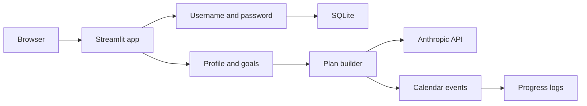

# Fitness tracker

A local Streamlit app for planning workouts, keeping a calendar, and logging body metrics. An account stays on this machine in SQLite. An optional Anthropic key turns a profile and weekly schedule into a workout plan.

## Architecture



| Page | Role |
| --- | --- |
| Dashboard | Goal, next week's completion, current weight |
| Profile | Body stats, schedule, exercise list, plan generation |
| Calendar | Sessions for the active plan |
| Progress | Weight and body-fat log |

Passwords are stored as bcrypt hashes. The database file `fitness.db` is gitignored. The Anthropic key belongs in `.streamlit/secrets.toml`, which is also gitignored. `.streamlit/secrets.toml.example` shows the shape of that file.

## Run

```bash
python3 -m venv .venv
source .venv/bin/activate
pip install -r requirements.txt
cp .streamlit/secrets.toml.example .streamlit/secrets.toml
streamlit run app.py
```

Open `http://localhost:8501`. The app works without an API key; plan generation needs `ANTHROPIC_API_KEY` in the secrets file.

`run_mobile.sh` starts the app and a temporary Cloudflare tunnel so a phone on another network can open it. `.streamlit/config.toml` listens on all interfaces and turns off CORS and XSRF protection for that local tunnel. Do not use those settings on a host that is open to the internet.
